# Community Fresh Market · 社区生鲜私域工具

> 面向中小商户的**私域经营工具**：微信小程序（顾客端 + 商家端）+ Java 后端。聚焦商品介绍、预约履约（配送 / 自提）与会员经营；**当面收款在线下完成，不做在线支付**。

[](https://openjdk.org/)
[](https://spring.io/projects/spring-boot)
[](https://developers.weixin.qq.com/miniprogram/)
[](https://www.postgresql.org/)
[](https://docs.docker.com/compose/)

<p align="center">
  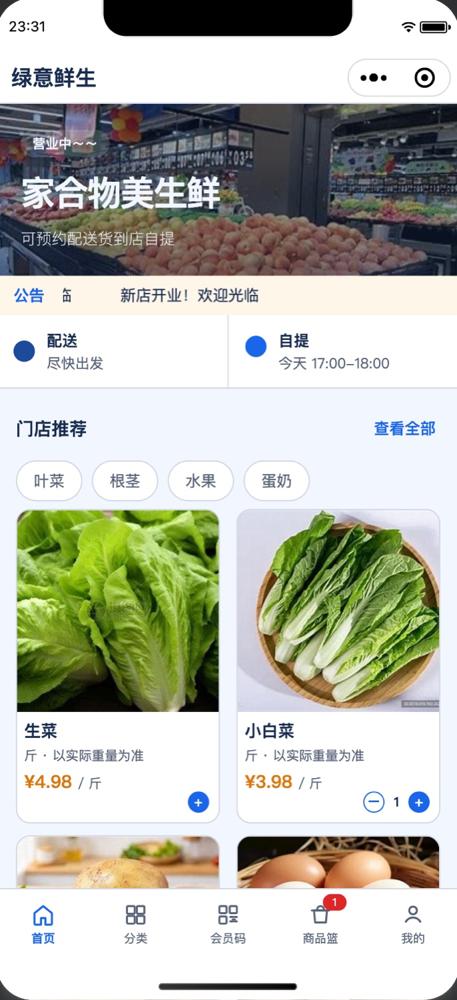
  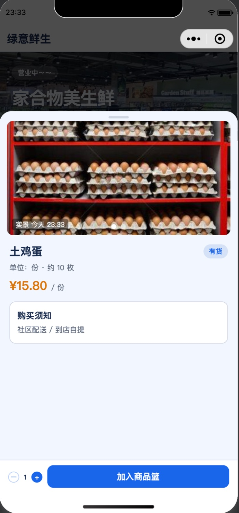
  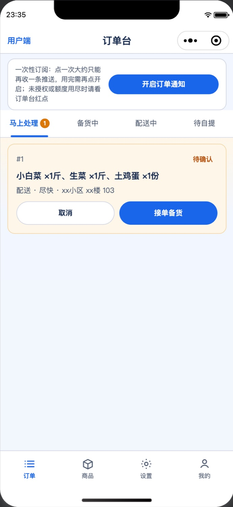
</p>
<p align="center"><sub>顾客首页 · 商品详情 · 商家订单台</sub></p>

## ✨ 产品能力（按波次交付）

**第一波 · 交易主链路**

- 商品与本店分类管理、商品篮、有货 / 售罄状态
- 预约下单：配送（尽快 + 备注 + 地址簿）/ 自提（商家时段）
- 订单状态机：待确认 → 备货中 → 配送中 / 待自提 → 已完成（未完成单双方可取消）
- 微信客服、订阅消息 + 红点、到货提醒、「再来一单」、自提「我到店了」、备注快捷短语

**第二波 · 经营深化**

- 积分体系（消费积分 / 积分兑换）、商品实景图、简单库存扣减、商品起购 / 限购

**第三波 · 会员与复购**

- 自建优惠券（领取 / 核销 / 有效期）、到店按金额补记积分（会员码 / 「冒个泡」）
- 余额台账、签到、店铺邀请、店铺主题装修（行业主题 / 首页橱窗）

## 📱 关键界面

<table>
  <tr>
    <td align="center" width="25%">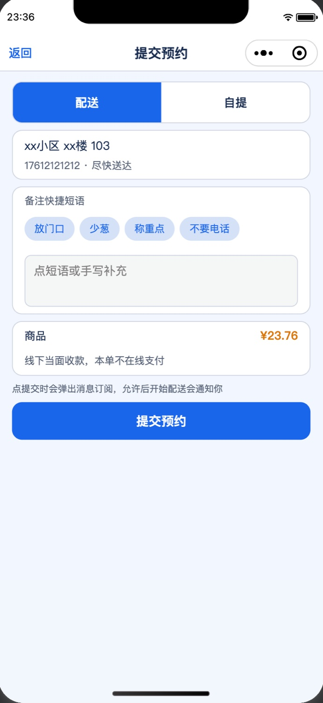<br/><sub>提交预约：配送 / 自提、备注快捷短语、线下收款说明</sub></td>
    <td align="center" width="25%">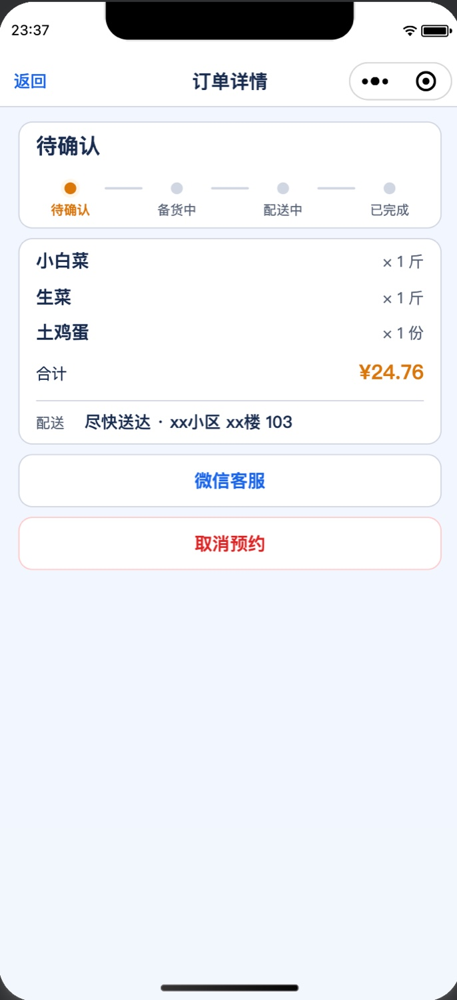<br/><sub>订单详情：状态进度、微信客服、取消预约</sub></td>
    <td align="center" width="25%">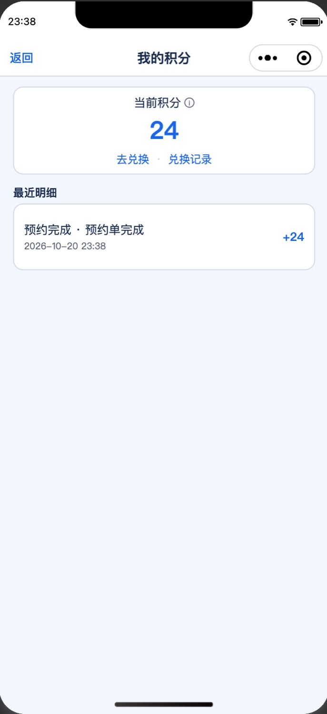<br/><sub>我的积分：预约完成自动入账、积分明细</sub></td>
    <td align="center" width="25%">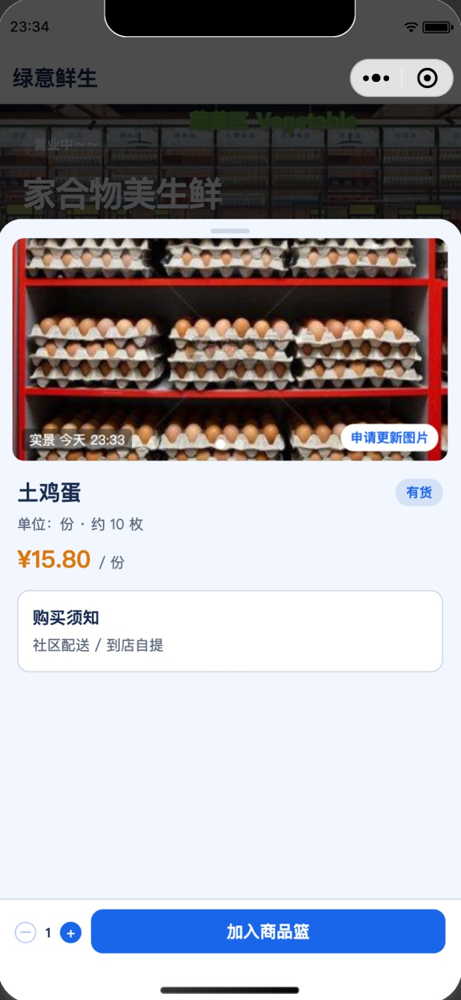<br/><sub>商品实景图：顾客可申请更新图片</sub></td>
  </tr>
  <tr>
    <td align="center" width="25%">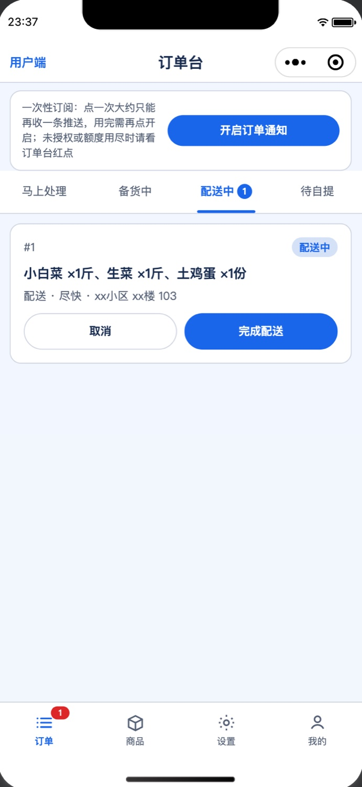<br/><sub>订单台：状态推进与红点提醒</sub></td>
    <td align="center" width="25%">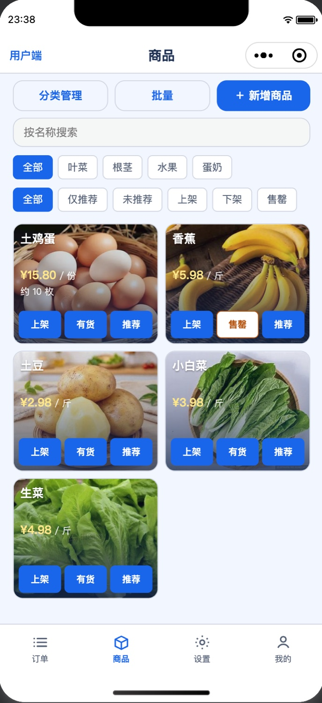<br/><sub>商品管理：上架 / 售罄 / 推荐、分类筛选</sub></td>
    <td align="center" width="25%">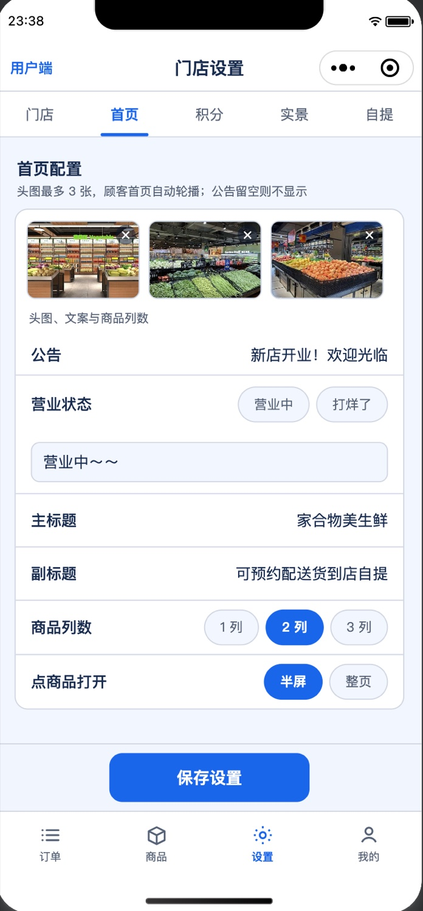<br/><sub>门店设置：首页头图、公告、列数与打开方式</sub></td>
    <td align="center" width="25%">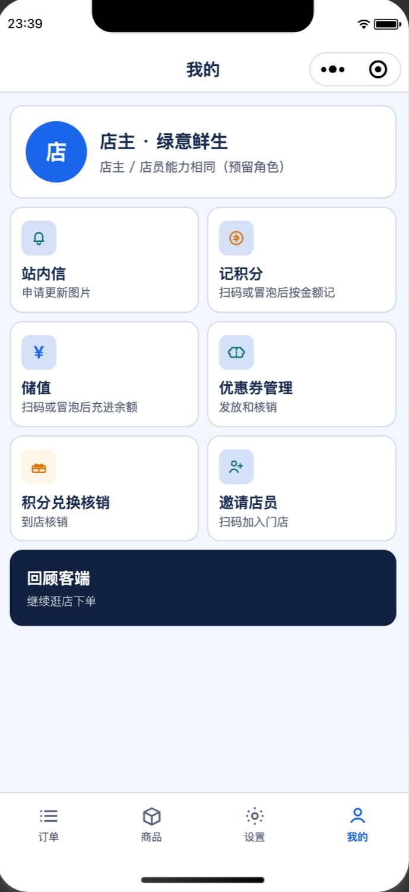<br/><sub>商家工作台：店主 / 店员同一套能力入口</sub></td>
  </tr>
</table>

## 🏗️ 技术架构

```
┌───────────────────────────────┐   ┌───────────────────────────────┐
│ 顾客端（小程序分包）            │   │ 商家端（小程序分包）            │
│ 首页/分类/商品篮/订单/我的      │   │ 订单台/商品管理/收银台/会员核销  │
└──────────────┬────────────────┘   └──────────────┬────────────────┘
               │          微信登录（wx.login）+ Session│
┌──────────────┴────────────────────────────────────┴───────────────┐
│  Spring Boot 3 · Java 17 · MyBatis-Plus                            │
│  auth(微信登录/拦截器) · catalog(商品/库存) · cart · order(状态机)  │
│  address · points · coupon · balance(台账) · cashier · checkin     │
│  livephoto · pick · notify(订阅消息) · store(店铺/主题) · upload    │
└──────────────┬─────────────────────────────────────────────────────┘
               │
   PostgreSQL（Flyway 28 个迁移脚本）· Redis · MinIO
   Docker Compose 一键部署 · storeId 隔离（多店预留）
```

- **架构决策**：业务后端自建 Java 服务而非微信云函数（规避调用次数限制）；顾客 / 商家共用一个小程序、分包隔离，店员身份由「店铺成员」表判定
- **数据设计**：全部业务数据带 `storeId` 隔离，单店先行、多店预留；schema 演进全程 Flyway 版本化（V1→V28 可追溯）
- **可靠性**：订单状态机显式建模、余额流水式台账、库存扣减、健康检查接口

## 🤖 AI 参与度（开发方式说明）

本项目以 **「设计文档 + 产品约束先行」** 的 Spec-driven 模式，全程借助 Cursor / CodeBuddy 等 AI 工具协作开发：

- **产品约束即护栏**：根目录 [AGENTS.md](AGENTS.md) 固化产品硬约束（不做在线支付、先单店可用、无 PC 端等）与**分期纪律**（「只实现当前波次，不提前做下一波」），AI 改代码前必读，从机制上防止范围蔓延
- **文档先行**：[产品设计](docs/plans/2026-10-07-product-design.md)、[技术方案](docs/plans/2026-10-07-technical-design.md)、[UI 原型说明](docs/plans/2026-10-07-ui-prototype.md)、[设计系统](design-system/communityfreshmarket/MASTER.md) 先行对齐，再进入编码；设计变更**先改文档再写代码**
- **可点击原型驱动**：[docs/prototypes/index.html](docs/prototypes/index.html) 浏览器直接打开的交互稿，作为 UI 验收基线
- **迭代决策留痕**：色彩系统、实景图、余额、店铺主题等专项设计均独立成文（[docs/plans/](docs/plans/) 共 10 篇），每次波次扩展都有决策记录
- **人工负责**：产品定义、波次规划、架构决策（支付边界 / 数据隔离 / 状态机）、代码审查；**AI 负责**：文档同步、模块化代码生成、迁移脚本、按约束执行迭代

> 一句话总结：**用 AGENTS.md 把产品边界和交付纪律写成 AI 的执行约束**——AI 是高效执行者，产品判断与架构决策始终由人把关。

## 🚀 快速启动

### 后端（Docker Compose 一键起）

```bash
git clone https://github.com/cmes1024/CommunityFreshMarket.git
cd CommunityFreshMarket/deploy
cp .env.example .env        # 配置微信 AppID/Secret、BOOTSTRAP_OWNER_OPENID 等
docker compose up -d --build

curl -s http://127.0.0.1:8088/api/v1/health   # 健康检查
```

> Compose 包含 PostgreSQL + Redis + MinIO + API；HTTPS 由宿主机反代；`BOOTSTRAP_OWNER_OPENID` 用于冷启动绑定店主。

### 小程序端

微信开发者工具打开 `miniprogram/`（详见[该目录 README](miniprogram/README.md)），在 `utils/config.js` 配置 `apiHost`。已打通：微信登录、逛店加购、地址簿、提交预约、商家接单履约。

### 冒烟测试

```bash
bash scripts/smoke-wave23.sh    # 二三波功能冒烟
```

## 📂 项目结构

```text
miniprogram/          顾客端 + 商家端（分包组织，原生小程序，无云开发）
server/               Spring Boot 3 服务（22 个业务包 + Flyway 迁移）
  └─ src/main/resources/db/migration/   V1→V28 版本化 schema
deploy/               Docker Compose 编排、Dockerfile、环境变量、更新脚本
design-system/        设计系统（MASTER + 页面级规范）
docs/plans/           产品 / 技术 / UI / 专项设计文档（10 篇）
docs/prototypes/      可点击 UI 原型（纯 HTML/CSS/JS）
docs/screenshots/     真机界面截图（README 配图）
AGENTS.md             AI 协作护栏：产品硬约束 + 分期纪律
```

## 📖 文档索引

- [产品设计](docs/plans/2026-10-07-product-design.md) · [技术方案](docs/plans/2026-10-07-technical-design.md) · [UI 原型说明](docs/plans/2026-10-07-ui-prototype.md)
- [二三波设计](docs/plans/2026-10-07-wave2-wave3-design.md) · [色彩系统](docs/plans/2026-10-08-color-system.md) · [店铺主题](docs/plans/2026-10-14-store-theme-design.md)
- [设计系统](design-system/communityfreshmarket/MASTER.md) · [可点击原型](docs/prototypes/index.html)
- [部署指南](deploy/README.md) · [Agent 协作指南](AGENTS.md)
